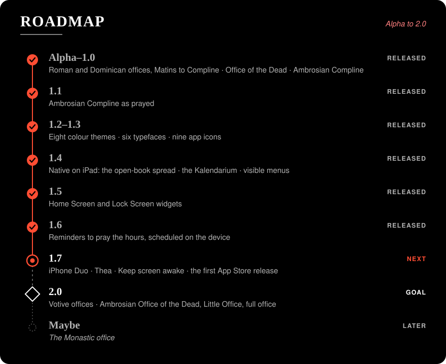

# Breviarium

An app for the **iPhone, the iPad and the iPhone Duo** that gives the traditional Divine
Office as it was prayed before the reform of 1970:

- the **Roman office** under the 1960 rubrics (*Breviarium Romanum*, 1962), with the
  Universal Calendar, the Vulgate psalter or the Pius XII psalter;
- the **Dominican office** of 1962 (*Ordo Prædicatorum*);
- **Ambrosian Compline** from the Ambrosian breviary of 1957.

It has all eight hours from Matins to Compline, the Martyrology, the Little Office of Our
Lady and the Office of the Dead, in Latin with an optional parallel English translation.
The app computes the office itself for any date, set like a printed book, with eight
colour themes and six typefaces. It is fully offline (no account, no tracking, no data
collected) and free software under the GPL.

On the App Store it will be **Breviarium 1962: Divine Office**: 1.7 is the version
prepared for its first release (see *Installing*).

## Status: 1.7

1.7 is built for the **iPhone Duo**: it fills the open screen, and held on its side it
opens into two pages like a book, with the Latin and the English facing each other. It
also adds a tenth app icon (*Thea*), *Keep screen awake*, and the dark Northumberland
icons on a Dark Home Screen.

| Release | What it added |
|---|---|
| [1.7](docs/releases/1.7.md) | The iPhone Duo, natively · Thea · *Keep screen awake* · Northumberland Inverted on a Dark Home Screen |
| [1.6.1](docs/releases/1.6.1.md) | Fixes from TestFlight: reminders open their hour, the Kalendarium opens on the day shown, the psalms' alternation |
| [1.6](docs/releases/1.6.md) | Reminders to pray the hours: local notifications, one per hour and one for the Martyrology, all off by default |
| [1.5](docs/releases/1.5.md) | Home Screen and Lock Screen widgets: the day, its colour and the hour, opening it when tapped |
| [1.4](docs/releases/1.4.md) | Native on the iPad, with a two-page spread · the Kalendarium · visible menus |
| [1.3](docs/releases/1.3.md) | Two more fonts and fixes from praying with 1.2 |
| [1.2](docs/releases/1.2.md) | Eight colour themes and the choice of font |

Earlier releases: [1.1](docs/releases/1.1.md) (Ambrosian Compline as prayed),
[1.0](docs/releases/1.0.md) (Ambrosian Compline, completing the first roadmap) and the
betas ([2](docs/releases/beta-2.md), [3](docs/releases/beta-3.md),
[4](docs/releases/beta-4.md), [5](docs/releases/beta-5.md)). The build log, with every
decision and every bug traced to the Divinum Officium source it was checked against, is in
[`docs/PLAN.md`](docs/PLAN.md); each release's plan is in `docs/` (`Beta_1_plan.md` to
`1.7_plan.md`).

**The office is checked, not assumed.** For every day from 2025 to 2040, each hour of the
Roman and Dominican offices is compared with
[Divinum Officium](https://github.com/DivinumOfficium/divinum-officium)'s own output, in
Latin and English and in both psalters: everything the app shows is on Divinum Officium's
page and nothing on it is missing, with the day title, the commemorations and each psalm.
All of 2044 is checked too, as a year the engine was never tuned against, and so are the
named hard cases: the Triduum, All Souls, transferred feasts, Our Lady on Saturday and
the rest. Where Divinum Officium's Dominican data is in error, the app shows the corrected
text, each case listed in [`docs/rubrics-op1962.md`](docs/rubrics-op1962.md). Ambrosian
Compline is checked page by page against its source
([`docs/ambrosian-compline-checks.md`](docs/ambrosian-compline-checks.md)).

How each hour is put together: [Vespers](docs/rubrics-1960-vespers.md),
[the day hours](docs/rubrics-1960-day-hours.md), [Matins](docs/rubrics-1960-matins.md),
[the Little Office, the Office of the Dead and the Martyrology](docs/rubrics-1960-votives.md),
[the Dominican office](docs/rubrics-op1962.md) and
[Ambrosian Compline](docs/rubrics-ambrosian-compline.md).

## Roadmap



The road to 1.0 is in [`docs/roadmap.md`](docs/roadmap.md), and the road to 2.0 in
[`docs/roadmap-2.0.md`](docs/roadmap-2.0.md): after the App Store release, votive offices
where the rubrics permit, the Ambrosian Office of the Dead and Little Office, and the full
Ambrosian office once a complete source is available, with Church of Ambrose's help. The
Monastic office is a *maybe, later*.

## Installing

- **The App Store** (once 1.7 is released there): *Breviarium 1962: Divine Office*, for
  iPhone, iPad and iPhone Duo with iOS 26 or later. This will be the normal way to
  install it.
- **TestFlight**, for trying a version before its release, by invitation.
- **Sideloading**, the fallback, with no Apple account beyond a free Apple ID:
  1. get an unsigned `.ipa` from the
     [Releases](https://github.com/ColdFrozenYeti/Breviarium/releases) page, or run the
     **Build IPA** workflow (Actions → Build IPA → Run workflow) and fetch it on Windows
     with `.\scripts\get-ipa.ps1` (it needs the GitHub CLI);
  2. sign and install it with AltStore/AltServer. A free Apple ID's signature lasts 7
     days and is renewed weekly.

  The sideloaded build has **no widgets**: a free Apple ID can't sign the widgets' App
  Group, so `build-ipa.yml` leaves the widget extension out. Everything else, reminders
  included, is the same. [`docs/install-on-iphone.md`](docs/install-on-iphone.md) covers
  the one-time setup and the weekly routine.

## Repository layout

| Path | What it is |
|---|---|
| `Packages/BreviariumKit/` | The engine: calendar, occurrence and concurrence, commemorations, hour assembly, text model. Pure Swift and Foundation, so it builds on Linux and Windows. Also `BreviariumData`, the build-time tool that turns the Divinum Officium texts into the app's bundled data file and the widgets' smaller one. |
| `App/Breviarium/` | The SwiftUI app (XcodeGen `App/project.yml`). Built only on CI. |
| `App/BreviariumWidget/` | The Home Screen and Lock Screen widgets (1.5). |
| `App/Shared/` | Code the app and the widgets share: the settings in the App Group, the widgets' data. |
| `App/BreviariumUITests/` | The UI and snapshot tests, run on an iPhone, an iPad and an iPhone Duo simulator, and the promo captures. |
| `data/divinum-officium/` | Divinum Officium, as a git submodule pinned to one commit (see `data/SOURCE.md`). |
| `data/oracle-fixtures/` | Divinum Officium's own rendered hours, the tests' reference: every day 2025–2040 for each hour, in each psalter and with English, and the 2044 hold-out year. |
| `docs/` | The plan and build log, each release's plan and notes (`docs/releases/`), the rubrics references for every hour and rite, the Divinum Officium file format, the App Store listing (`docs/app-store/`), and setup and install guides. |
| `scripts/` | Test runners, fixture generators, the CI simulator helpers (`ci-simulator.sh`, `duo-open.sh`), the App Store screenshots, previews and images (`scripts/promo/`), and the Windows `.ipa` fetcher. |
| `site/` | The website the App Store listing links to, with the privacy policy and support pages: [breviarium.eduardopavone.eu](https://breviarium.eduardopavone.eu/). |
| `.github/workflows/` | The CI, listed below. |

The workflows:

| Workflow | What it does |
|---|---|
| `kit-ci.yml` | Builds the engine and runs its fast tests, on Linux. |
| `oracle-audits.yml` | The full-range checks against Divinum Officium, every hour and both rites, split across jobs. |
| `app-ci.yml` | Builds the app and runs the UI tests on iOS 27.2 simulators (iPhone 17, iPad Air 11", iPhone Duo open upright and on its side), uploading the snapshot PNGs. |
| `build-ipa.yml` | The unsigned `.ipa` for sideloading, without the widget extension. |
| `testflight.yml` | The signed archive, uploaded to App Store Connect for TestFlight and the App Store. |
| `promo.yml` | The App Store screenshots and screen recordings, on an iPhone, an iPad and the iPhone Duo. |
| `pages.yml` | Publishes `site/` to GitHub Pages. |

## Development

There is no Mac. The engine and its tests build anywhere with the open-source Swift
toolchain; the app is built only on GitHub Actions' macOS runners (Xcode 27.2).

Clone with the submodule:

```
git clone --recurse-submodules https://github.com/ColdFrozenYeti/Breviarium.git
```

**Engine and tests** (Linux, macOS or Windows, open-source Swift 6 toolchain, no Xcode):

```
cd Packages/BreviariumKit
swift build
swift test --skip "vespersFullRange|dayHoursFullRange"   # the fast suite, as Kit CI runs it
swift test --filter vespersFullRange     # Vespers' full-range oracle audits (~30 min)
swift test --filter dayHoursFullRange    # the day hours' full-range audits (a few hours on one core)
BREVIARIUM_AUDIT_HOURS=Laudes swift test --filter dayHoursFullRange   # one hour only
BREVIARIUM_AUDIT_STRIDE=7 swift test --filter vespersFullRangeEnglishAudit   # a quick 1-in-7 sample
```

`scripts/test-kit.sh` and `scripts/test-kit.ps1` wrap the build and tests. For first-time
Windows setup, see [`docs/windows-swift-setup.md`](docs/windows-swift-setup.md).

What the tests check:

- **Oracle tests** compare the engine with Divinum Officium's own output: named tests for
  specific dates, each citing the source it was checked against, and full-range audits of
  every day 2025–2040 in both directions (what we show is on Divinum Officium's page, and
  what its page shows is in ours).
- **Fixtures** are regenerated from the pinned checkout by
  `scripts/generate-oracle-fixtures.sh` (in Docker), `scripts/generate-holdout-fixtures.sh
  <year>` and `scripts/generate-fixture-set.sh`.
- **Never "fix" a failing oracle test by editing a fixture.**
- **The app's snapshots** are measured against `CLAUDE.md`'s visual specification.

[`CLAUDE.md`](CLAUDE.md) holds the project rules: scope, visual specification, testing
discipline and the non-negotiables.

## Credits and licence

Breviarium is free software under the **GNU General Public License, version 3 or later**
([`LICENSE`](LICENSE)): anyone may use, study, share and change it, and every version
distributed must stay free and come with its source. [`NOTICE.md`](NOTICE.md) has the
copyright, an additional permission for app stores such as the App Store (the source must
still be offered free under the GPL), and every third-party credit:

- the Latin and English texts and the rubrical logic of the Roman and Dominican offices
  come from [Divinum Officium](https://github.com/DivinumOfficium/divinum-officium) (MIT
  licence), pinned to one commit (see [`data/SOURCE.md`](data/SOURCE.md)); its notice is
  on the app's About screen;
- Scripture in English is the Douay-Rheims Bible (public domain);
- Ambrosian Compline and its calendar are Church of Ambrose's transcription of the 1957
  Ambrosian breviary, used with its owners' written permission, and not covered by the
  GPL;
- the bundled fonts (Gentium Book Plus, Source Sans 3, IBM Plex Mono, Comic Neue) are
  under the SIL Open Font License;
- the ten app icons are the author's designs from images on Wikisource and Wikimedia
  Commons, all public domain but two: the Gutenberg pair's image is CC BY 2.0 (Biblioteca
  General Antonio Machado), and Thea's is CC BY-SA 4.0 (Manuscriptorium / National Library
  of the Czech Republic), so the Thea icon files are CC BY-SA 4.0. The credits are on the
  About screen.

The reading view is modelled on the night mode of Universalis, which gives the current
Liturgy of the Hours; Universalis Publishing agreed to the design in writing. The icon,
an illuminated B, was made to [`docs/icon-spec.md`](docs/icon-spec.md).
